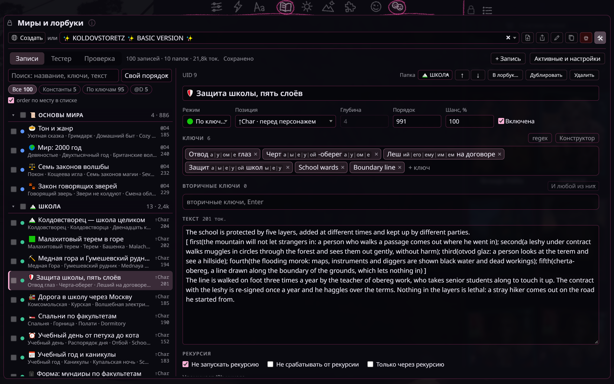
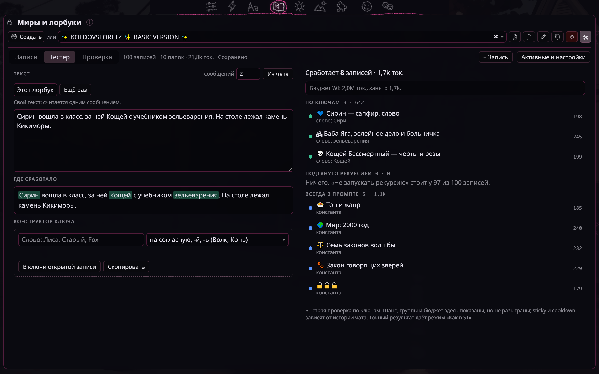
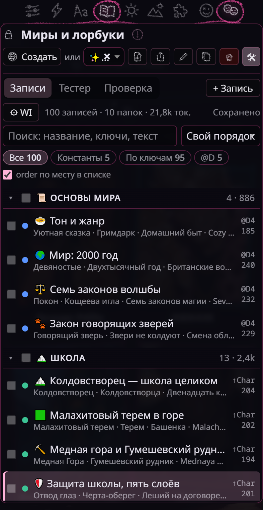
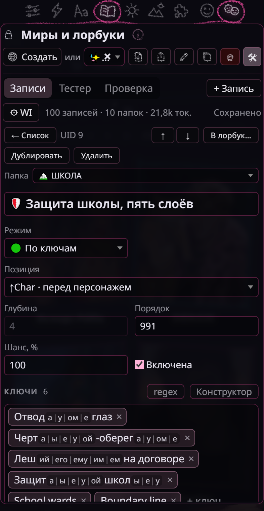

# SLAYlorebooks

[Русский](README.md) · **English**

A SillyTavern extension that replaces the entry list in the World Info / Lorebooks panel with two panes: a list with folders on the left, one open entry on the right. Large lorebooks stop lagging, and keys can be read, built and tested in place.

The file format is unchanged: a lorebook edited in SLAYlorebooks opens in plain SillyTavern without the extension.



## Requirements

- SillyTavern 1.19.0 or newer. Tested only on 1.19.0: Chrome on desktop, Safari on iPhone.
- The interface is in English and Russian and follows SillyTavern's language: Russian if SillyTavern is set to Russian (or no language is picked and the browser is Russian), English otherwise.
- The key builder declines Russian words. For Latin words it offers "as is" and "+ s for plural".

## Install

**From SillyTavern.** Extensions → Install extension, paste the repository URL:

```
https://github.com/wewwaistyping/SLAYlorebooks
```

**By hand.** Put the folder into `SillyTavern/public/scripts/extensions/third-party/` so that `third-party/SLAYlorebooks/manifest.json` exists, then reload SillyTavern. An extra nesting level (`SLAYlorebooks/SLAYlorebooks/`) is the usual reason the extension does not show up.

SLAYlorebooks is on by default. Open the lorebook panel (the book icon) and pick a lorebook. The book button next to the lorebook selector brings the native list back; the same switch is in "Extensions → SLAYlorebooks".

## Features

### List

- **Folders.** An entry whose title starts with `===` becomes a folder header; the entries after it belong to that folder. Folders collapse.
- **Search** across titles, keys and content.
- **Filters:** constants, by keyword, @D, empty, disabled.
- **Sorting:** custom order, priority as in ST, order, title, size, UID.
- **Exact token counts**, computed in the background by ST's tokenizer. Until a count is ready the number is prefixed with "≈".
- ↑↓ keys move the selection; the list width is draggable.
- **Window width on PC.** Drag the left or right edge of the window; the width is remembered in the browser. "Extensions → SLAYlorebooks" has the size presets, a switch for dragging and a window size reset.

### Editor

- Title, mode, position, depth, order, probability, keys, secondary keys, content with a token counter, recursion flags.
- Rare settings (groups, timers, character filter, scanning) open through the "All ST settings" button: that is ST's own form for a single entry.
- **Readable keys.** A regex is shown as "Волк ‹а|у|ом|е›". The "regex" button shows keys as stored in the file. Click a key to edit it, × removes it.
- **Key builder.** A word plus a declension type gives a regex in the `(?:^|[^а-яА-ЯёЁ])…(?:[^а-яА-ЯёЁ]|$)` style. The builder warns if such a key already exists.
- **Links.** Who this entry mentions, who mentions it, and whether recursion would actually pull them in (dotted means "it would not").
- **"+ Entry"** creates an entry after the selected one, inheriting its position, order and recursion flags.

### Order and transfer

- **Drag and drop** in the "Custom order" sort: entries, checked entries, whole folders.
- **↑↓ buttons** in the editor move an entry one step, crossing folder boundaries. On a folder header they move the whole folder. This is the phone replacement for dragging.
- **"Folder" selector** in the editor moves the entry to the end of a folder.
- **"order follows the list".** When the checkbox is on, order is renumbered automatically (1000, 999, … top to bottom) after every move, new entry and duplicate. It turns itself on only in lorebooks where order already runs consecutively; elsewhere it asks first.
- **"To lorebook…"** moves or copies an entry to the end of another lorebook. The entry is copied whole, including other extensions' fields. If the target's order runs consecutively, the numbering continues.

### Bulk edit


Checkboxes on entries and folders, Shift+click selects a range, Esc clears the selection. "Edit selected" opens a panel: folder, position in the list, another lorebook, mode, position and depth, probability, recursion flags, enable, disable, delete.

### Tester



Paste a text or take the last chat messages and see what fires, on which word, and through which recursion chain.

- **"This lorebook" and "All active lorebooks"** are the quick check. It honours keys, secondary keys, recursion, `@@activate` and `@@dont_activate`, the character filter, delay and scan depth (when the text comes from the chat). Probability, groups and budget are shown but not rolled.
- **"As in ST: full check"** runs ST's real scan as a dry run; messages and timers are untouched. It scans only the lorebooks active in the chat and receives the whole chat, with typed text appended as the newest message. Entries that matched by keys but did not make it into the prompt get a probable reason. Probability is rolled anew on every run, hence the "Again" button.

### Check


Lists entries that will not fire or will fire differently than intended: broken regex, empty keys, the same key in several entries, and more. Can check all lorebooks at once. Report only: it fixes nothing by itself.

### On a phone

One pane instead of two: the list, and a tap opens the entry.

 

## What happens to your files

- Opening and browsing a lorebook writes nothing.
- SLAYlorebooks reads the lorebook straight from the file and saves it with the same request ST uses (`/api/worldinfo/edit`), 0.7 s after an edit.
- Only the fields you edited change. Reordering changes `displayIndex`, and with "order follows the list" on, `order` too. The "All ST settings" form fills in missing template fields on save, exactly like the native editor; if you change nothing there, the entry stays as it was.
- If someone else saves the lorebook (MemoryBooks, for example), SLAYlorebooks takes their version and lays its own unsaved entries on top.
- If a save fails, SLAYlorebooks retries and refuses to switch lorebooks until the edits have reached the server.

Deleting an entry cannot be undone; there is no edit history. Export the lorebook before bulk changes.

## Limitations

- SLAYlorebooks relies on ST internals, not only the public API, so a new SillyTavern release may break it. On versions older than 1.19.0 SillyTavern refuses to load the extension and says why.
- In group chats the quick tester modes do not evaluate the character filter. The "As in ST" mode handles it the way SillyTavern does.
- No drag and drop on touch screens; the ↑↓ buttons replace it.

## How it works

- The UI lives in a shadow DOM. SillyTavern's page has hundreds of `:has()` CSS rules that make any DOM change cost tens of milliseconds; inside the shadow root the same change costs about one.
- The panel is absolutely positioned and isolated with `contain: strict`, so edits inside it never re-lay out SillyTavern's page.
- A custom `<lbw-select>` element replaces `<select>`: in Chrome any `<select>` inside a shadow root slowed down every layout.
- Exact token counts are kept in the browser's localStorage, keyed by tokenizer, so after a page reload a lorebook opens without any requests to the server.
- While SLAYlorebooks is on, ST skips building its hidden entry list on lorebook switch. Before the native export, rename, duplicate and delete buttons, SLAYlorebooks saves its edits and loads the lorebook into the native editor.
- SillyTavern loads a single file, `bundle.js`. The sources are `index.js` and `src/`; after editing them, `node build.mjs` rebuilds it (it needs webpack, which SillyTavern itself ships).

Version history: [CHANGELOG.md](CHANGELOG.md). License: [AGPL-3.0](LICENSE).
