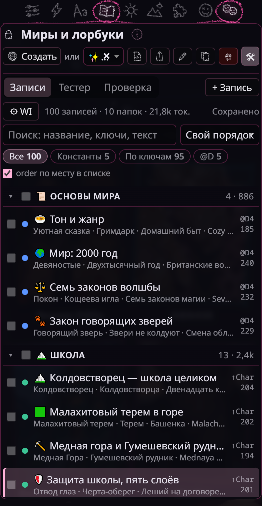
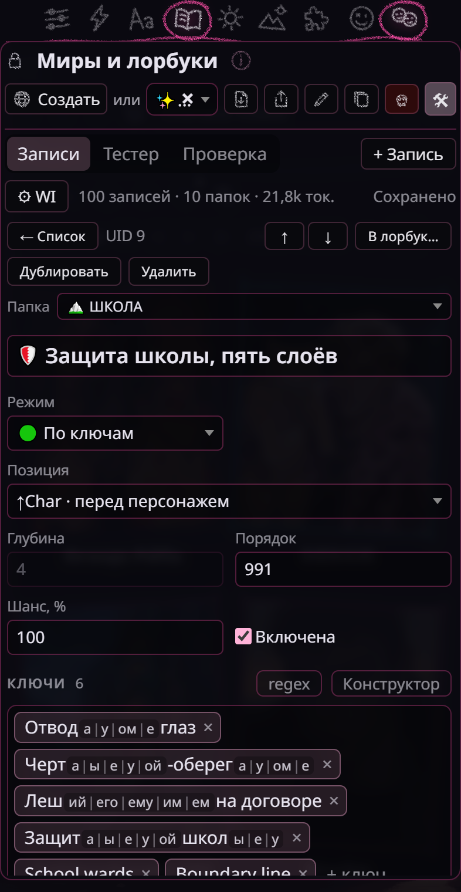

# SLAYlorebooks

**Русский** · [English](README.en.md)

Расширение для SillyTavern. Заменяет список записей в панели лорбуков на две панели: слева список с папками, справа одна открытая запись. Большие лорбуки перестают тормозить, а ключи можно читать, собирать и проверять прямо на месте.

Формат файлов не меняется: лорбук, отредактированный в SLAYlorebooks, открывается в обычной таверне и без расширения.


## Требования

- SillyTavern 1.19.0 или новее. Проверено только на 1.19.0: в Chrome на ПК и в Safari на iPhone.
- Интерфейс на русском и английском. Язык задаёт таверна: при русском (или если язык не выбран, а браузер русский) всё на русском, при любом другом на английском.

## Установка

**Через таверну.** Extensions → Install extension, вставить адрес репозитория:

```
https://github.com/wewwaistyping/SLAYlorebooks
```

**Вручную.** Положить папку в `SillyTavern/public/scripts/extensions/third-party/`, чтобы получилось `third-party/SLAYlorebooks/manifest.json`, и перезагрузить таверну. Лишняя вложенность (`SLAYlorebooks/SLAYlorebooks/`) — частая причина, почему расширение не видно.

SLAYlorebooks включается сам. Откройте панель лорбуков (иконка книги) и выберите лорбук. Кнопка с книгой рядом с выбором лорбука возвращает родной список, то же самое есть в «Расширения → SLAYlorebooks».

## Что умеет

### Список

- **Папки.** Запись, чьё название начинается с `===`, становится заголовком папки, следующие записи лежат в ней. Папки можно сворачивать.
- **Поиск** по названию, ключам и тексту.
- **Фильтры:** константы, по ключам, @D, пустые, выключенные.
- **Сортировки:** свой порядок, приоритет как в ST, order, название, размер, UID.
- **Токены** точные, их считает токенизатор ST в фоне. Пока число не готово, перед ним стоит «≈».
- Клавиши ↑↓ двигают выбор, ширину списка можно тянуть мышью.
- **Ширина окна на ПК.** Окно можно тянуть за левый или правый край, ширина запоминается в браузере. В «Расширения → SLAYlorebooks» можно выбрать размер, отключить перетаскивание и сбросить размер окна.

### Редактор

- Название, режим, позиция, глубина, порядок, шанс, ключи, вторичные ключи, текст со счётчиком токенов, флаги рекурсии.
- Редкие настройки (группы, таймеры, фильтр персонажей, сканирование) открывает кнопка «Все настройки ST»: это родная форма ST для одной записи.
- **Читаемые ключи.** Regex показывается как «Волк ‹а|у|ом|е›». Кнопка «regex» показывает ключи как они записаны в файле. Клик по ключу открывает его правку, × удаляет.
- **Конструктор ключа.** Слово и тип склонения дают regex в стиле `(?:^|[^а-яА-ЯёЁ])…(?:[^а-яА-ЯёЁ]|$)`. Конструктор предупреждает, если такой ключ уже есть.
- **Все ключи в regex.** Кнопка "Аа→ regex" над ключами делает regex со склонениями из всех обычных ключей записи сразу. Нажми на ключ, чтобы сменить окончания; жёлтая точка значит, что склонение не угадать по слову. "Вернуть как было" отменяет всё разом.
- **Связи.** Показывают, кого запись упоминает и кто упоминает её, и подтянет ли рекурсия на самом деле (пунктир значит «не подтянет»).
- **«+ Запись»** создаёт запись после выбранной с её позицией, order и флагами рекурсии.

### Порядок и перенос

- **Перетаскивание мышью** в сортировке «Свой порядок»: записи, отмеченные записи, папки целиком.
- **Кнопки ↑↓** в редакторе двигают запись на одну позицию и через границу папки. У заголовка папки двигают папку целиком. Это замена перетаскиванию на телефоне.
- **Выбор «Папка»** в редакторе переносит запись в конец папки.
- **«order по месту в списке».** Когда галочка включена, order пересчитывается сам (1000, 999, … сверху вниз) после каждой перестановки, новой записи и дубля. Сама она включается только там, где order уже идёт подряд, в остальных лорбуках спрашивает разрешение.
- **«В лорбук…»** переносит или копирует запись в конец другого лорбука. Запись копируется целиком, со служебными полями других расширений. Если в целевом лорбуке order идёт подряд, нумерация продолжается.

### Массовая правка


Галочки у записей и папок, Shift+клик выделяет диапазон, Esc снимает выделение. «Править выбранные» открывает панель: папка, место, другой лорбук, режим, позиция и глубина, шанс, флаги рекурсии, включить, выключить, удалить.

### Тестер


Вставляете текст или берёте последние сообщения чата и видите, что сработает, на каком слове и через какую цепочку рекурсии.

- **«Этот лорбук» и «Все активные лорбуки»** — быстрая проверка. Учитывает ключи, вторичные ключи, рекурсию, `@@activate` и `@@dont_activate`, фильтр персонажей, delay и глубину сканирования (если текст взят из чата). Шанс, группы и бюджет показывает, но не разыгрывает.
- **«Как в ST: полная проверка»** запускает настоящее сканирование ST вхолостую, сообщения и таймеры не меняются. Сканирует только лорбуки, активные в чате, и получает весь чат, а набранный текст идёт новым сообщением поверх него. Для записей, которые совпали по ключам, но не попали в промпт, пишет вероятную причину. Шанс разыгрывается заново при каждом прогоне, для этого есть кнопка «Ещё раз».

### Проверка


Показывает записи, которые не сработают или сработают не так, как задумано: сломанный regex, пустые ключи, один и тот же ключ в нескольких записях и другое. Умеет проверить все лорбуки разом. Только отчёт: сама ничего не исправляет.

### На телефоне

Вместо двух панелей одна: список, по нажатию открывается запись.

 

## Что происходит с вашими файлами

- Открытие и просмотр лорбука ничего не записывают.
- SLAYlorebooks читает лорбук прямо из файла и сохраняет его тем же запросом, что ST (`/api/worldinfo/edit`), через 0,7 с после правки.
- Меняются только поля, которые вы правили. Перестановка записей меняет `displayIndex`, а при включённой галочке «order по месту» ещё и `order`. Форма «Все настройки ST» при сохранении дописывает записи недостающие поля из шаблона ST, как и родной редактор; если в ней ничего не менять, запись остаётся как была.
- Если лорбук сохранил кто-то другой (например, MemoryBooks), SLAYlorebooks берёт его версию и накладывает сверху свои несохранённые записи.
- Если сохранить не вышло, SLAYlorebooks повторяет попытку и не даёт переключить лорбук, пока правки не уйдут на сервер.

Удаление записи отменить нельзя, истории правок нет. Перед массовыми изменениями лучше сделать экспорт лорбука.

## Ограничения

- SLAYlorebooks опирается на внутренние функции ST, а не только на публичный API, поэтому новая версия таверны может его сломать. На версии старше 1.19.0 таверна не запустит расширение и покажет причину.
- В групповых чатах быстрые режимы тестера не проверяют фильтр персонажей. Режим «Как в ST» учитывает его как сама таверна.
- На сенсорных экранах нет перетаскивания, вместо него кнопки ↑↓.

## Как устроено

- Интерфейс живёт в Shadow DOM. На странице таверны сотни CSS-правил с `:has()`, из-за них любое изменение страницы стоит десятки миллисекунд, внутри shadow root — около одной.
- Панель позиционирована абсолютно и изолирована через `contain: strict`, поэтому правки в ней не пересчитывают страницу таверны.
- Вместо `<select>` используется свой элемент `<lbw-select>`: в Chrome любой `<select>` внутри shadow root замедлял каждую раскладку.
- Точные токены запоминаются в localStorage браузера с привязкой к токенизатору, поэтому после перезагрузки страницы лорбук открывается без запросов к серверу.
- Пока SLAYlorebooks включён, ST не строит свой скрытый список при смене лорбука. Перед родными кнопками экспорта, переименования, дубля и удаления SLAYlorebooks сохраняет правки и загружает лорбук в родной редактор.
- Таверна загружает один файл `bundle.js`. Исходники лежат в `index.js` и `src/`; после правок его пересобирает `node build.mjs` (нужен webpack, он есть в самой таверне).

История версий: [CHANGELOG.md](CHANGELOG.md). Лицензия: [AGPL-3.0](LICENSE).
